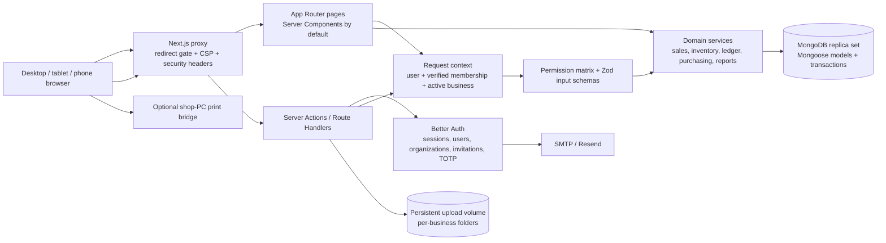

# StockPilot system design

## Product boundary

StockPilot is a multi-tenant inventory, billing and POS application for small businesses. A signed-in person can belong to more than one business. Each request resolves one active business from the authenticated membership; the browser never supplies a trusted tenant context. Business operations run on the server. The browser holds presentation state and a small offline POS cache for an explicitly registered till.

## Runtime architecture

`src/app` owns routes and page composition. `src/components` owns interactive UI leaves. `src/server/actions` adapts client calls to server-side operations. `src/server/services` owns business rules and transaction boundaries. `src/server/models` defines persisted records and tenant query guardrails. `src/lib` contains pure calculations and schemas.

## Request and authorization flow

1. The Next.js proxy provides an early redirect for pages without a session cookie and attaches a per-request nonce plus browser security headers. It is only an optimistic gate; it is not the authorization boundary.
2. Server pages call `requireCtx(permission)` when they need a particular capability. `loadCtx()` reads the Better Auth session, validates the user's organization membership in MongoDB, resolves the active business and derives the role server-side.
3. Mutations call a server action wrapped by `withAuth(permission, schema, handler)`. The wrapper authenticates, checks the role, validates the input and maps unexpected errors to a safe response before the handler reaches domain services.
4. Custom route handlers authenticate and authorize independently. Uploads additionally check same-origin requests, throttle by user/business, cap the actual multipart byte stream, inspect file signatures and use tenant-scoped storage paths.

Roles are centralized in `src/lib/permissions.ts`. UI visibility follows the same policy for usability, but a hidden control is never considered security enforcement.

## Tenant isolation

Every business record has an `orgId`. Database reads and writes include that ID, and `tenantPlugin` rejects unscoped query operations and aggregates that do not begin with an organization match. Authentication and global rate-limit records are deliberately not tenant models. Public bill tokens are a separate, signed capability path and should be treated as shareable bearer secrets.

Uploads are addressed separately from business IDs: image URLs carry the organization ID and are served only to a current member of that organization. Supplier documents are stored under an organization-specific directory and require purchase-read permission. Legacy flat image files are served only when the current organization already references them.

## Data and transaction design

| Domain | Main records | Invariants |
|---|---|---|
| Catalogue | Product, Category, TaxRate, Batch, Serial | Product variants own SKU and barcode uniqueness within a business; batch and serial tracking are mutually exclusive. |
| Inventory | StockLevel, StockMove, Location | Stock levels are the current balance; immutable movement records explain changes. Mutations run with the associated document transaction. |
| Sales | Sale, till counters, held bills | Sale, payment, stock movement, ledger and numbering changes must commit or roll back together. Offline submissions use client IDs for idempotency and surface conflicts for review. |
| Purchasing | PurchaseOrder, supplier Party, attachments | Receipts and returns update inventory and supplier balances with an auditable movement. |
| Accounts | Party, Payment, LedgerEntry | Payments allocate against documents; corrections are reversed with a reason rather than erased. |
| Governance | AuditLog, OrgSettings, e-invoice credentials | Business activity is tenant-scoped; stored external credentials are encrypted by the application. |

MongoDB must run as a replica set because the application uses multi-document transactions for sales, stock, ledger and numbering. `inTransaction()` centralizes transaction lifecycle and relies on MongoDB's transient transaction retry behavior.

## Offline POS

The service worker caches the POS application shell. Each till stores a bounded business snapshot and an offline sale queue in browser storage. A local till sequence gives bills a final number before connectivity returns. Synchronization uses an idempotent client ID; server-side business rules recheck stock, price, serial and credit constraints. Conflicts are retained for staff review instead of being silently discarded. Customer creation and operations that require live external systems remain online-only.

## External integrations

- **Email:** Better Auth invokes `sendMail`, configured for Resend, SMTP, or a local test sink.
- **E-invoice:** a server-side NIC client validates hosts, uses bounded network timeouts and encrypts saved credentials. Production NIC behavior still requires sandbox verification against current portal/API specifications.
- **Printing:** browser printing is the default. The optional print bridge is a separate shop-PC process and should only be configured on a trusted local network with its pairing key protected.

## Deployment shape

The Docker image builds Next.js once and runs it as a non-root user. Production needs a replica-set MongoDB connection, a strong Better Auth secret, HTTPS, a persistent upload volume, and an email provider. Railway's health check calls `/api/health`; it verifies database reachability and replica-set support. The Docker Compose stack is suitable for local or single-host use, not a high-availability production deployment.

For horizontal application scaling, keep application instances stateless. Use shared persistent/object storage for uploads, a managed replica-set database with backups, a centralized secret manager, and centrally collected security/application logs. Deployment region, retention, backup encryption, incident response, subprocessors and Data Fiduciary/Processor roles are operational/legal decisions and cannot be guaranteed by application code alone.

## Verification design

- Unit tests cover pure logic and parsing.
- Integration tests use an in-memory MongoDB replica set to exercise transactions, role gates, tenant isolation, offline sync, imports and NIC mocks.
- Playwright tests exercise browser journeys and role-specific route access using a disposable database. E2E mail, upload, camera and build artifacts are isolated from normal development data and the running dev build.
- `npm run typecheck`, `npm run lint`, `npm run test`, `npm run test:int`, `npm run e2e`, `npm run build` and `npm audit` are the release checks. Production-like deployment validation remains necessary for storage, email, TLS/proxy headers and NIC connectivity.
